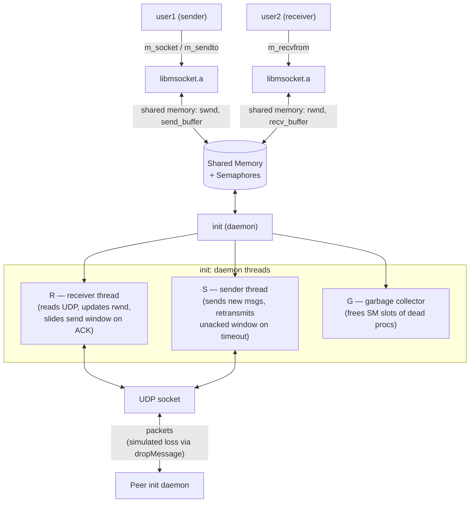
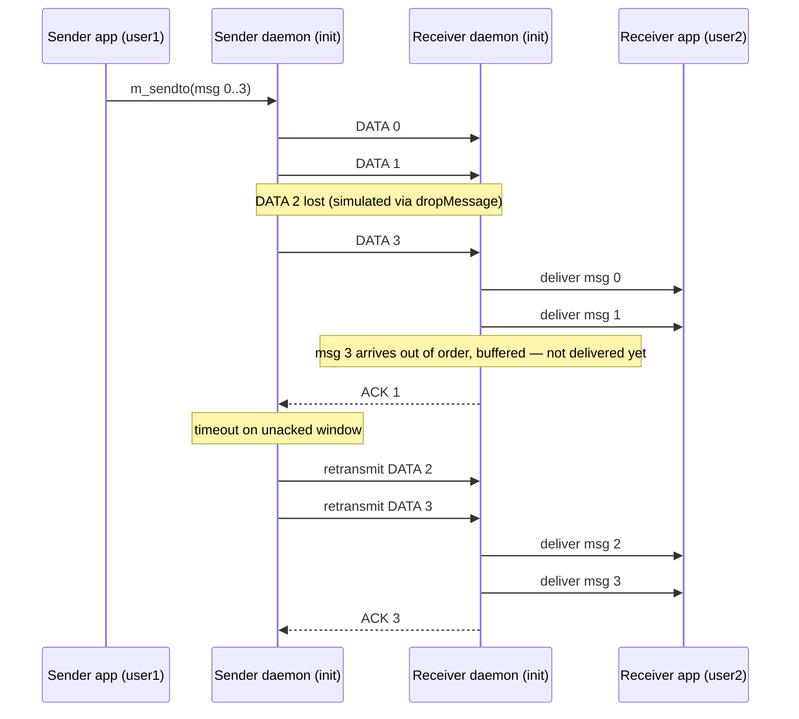

# RUDP — Reliable Message Transport over UDP

A message-oriented transport protocol built from scratch on raw UDP sockets,
giving TCP-like guarantees (in-order delivery, loss recovery) without TCP's
connection setup and byte-stream overhead. Built as a way to get hands-on
with sliding-window ARQ, POSIX shared memory, and multithreaded daemon design
in C.

## Why

TCP hides all of this behind a socket API. I wanted to actually implement the
pieces it's built on — sequence numbers, ACKs, a retransmission timer, a
sliding window — and see how they behave under simulated packet loss, rather
than just reading about them.

This was built against the spec in
[`docs/assignment-spec.pdf`](docs/assignment-spec.pdf) — it lays out the
exact API surface, IPC constraints, and correctness requirements the
implementation targets.

## Features

- **Go-Back-N ARQ** — a sliding window protocol that detects dropped packets
  and retransmits unacknowledged data automatically.
- **Multithreaded daemon** — a background process (`init`) runs independent
  sender, receiver, and garbage-collection threads, so applications never
  block on network I/O.
- **Shared-memory IPC** — user processes and the daemon exchange data through
  POSIX shared memory instead of extra syscalls per message.
- **Familiar API** — mirrors standard socket programming: `m_socket`,
  `m_bind`, `m_sendto`, `m_recvfrom`, `m_close`.
- **Loss simulation** — a configurable drop probability lets you stress-test
  the protocol without needing an actually lossy network.

## Architecture



### The daemon (`initmsocket.c`)

Runs three threads so applications never block on the network:

- **R — receiver thread**: listens for UDP packets. Data packets are placed
  in the receive buffer and the advertised receive window (`rwnd`) is
  updated; ACKs slide the sender window forward.
- **S — sender thread**: periodically checks the send buffer. On a timeout it
  retransmits the whole in-flight window (Go-Back-N); otherwise it sends
  newly queued messages.
- **G — garbage collector**: reclaims shared-memory segments belonging to
  processes that have exited.

### Shared memory (`msocket.h`)

The daemon and applications talk through shared structs:

- **`swnd`** — send window: `send_window_size`, `unack_time`, message
  lengths, and circular-buffer indices (`start_index`, `last_sent_index`,
  `end_index`).
- **`rwnd`** — receive window: `receive_window_size`, `last_inorder_msg`,
  sequence numbers, and buffer indices.

### Go-Back-N in action



### Application API (`msocket.c`)

Applications link against `libmsocket.a`:

| Call | Purpose |
|---|---|
| `m_socket(domain, type, protocol)` | Requests an RUDP socket; the daemon allocates its shared-memory slot. |
| `m_bind(sockfd, src, srclen, dst, dstlen)` | Binds the socket to a source/destination address. |
| `m_sendto(sockfd, msg, len, flags, dst, dstlen)` | Queues a message in the shared send buffer for the daemon to transmit. |
| `m_recvfrom(sockfd, buf, len, flags, addr, addrlen)` | Pulls the next in-order message from the receive buffer. |
| `m_close(sockfd)` | Marks the socket inactive for the garbage collector to reclaim. |

More implementation detail, including a small retransmission-vs-loss-rate
measurement, is in [`docs/design-notes.md`](docs/design-notes.md).

## Requirements

This is POSIX/System V code (`sys/shm.h`, `sys/sem.h`, pthreads) — it needs a
Unix-like environment:

| Platform | Status |
|---|---|
| Linux | Works — this is what it's built and tested against. |
| WSL (Windows Subsystem for Linux) | Works — verified end-to-end on WSL Ubuntu 24.04 + gcc 13. |
| macOS | Should work (the same POSIX/SysV IPC headers exist), but **not tested**. macOS's default System V shared-memory limits are very small and may need raising via `sysctl` if `shmget` fails. |
| Native Windows (no WSL) | **Will not build.** MSVC/MinGW don't provide `sys/shm.h`, `sys/sem.h`, or `<pthread.h>` in the form this code expects. Use WSL instead. |

You'll also need `gcc` and `make`. On Debian/Ubuntu (including WSL):

```bash
sudo apt update && sudo apt install build-essential
```

## Getting the code

```bash
git clone https://github.com/amanjuneja420/Reliable-UDP-Based-Protocol-Design.git
cd Reliable-UDP-Based-Protocol-Design
```

## Building

Three small, single-purpose Makefiles — build the static library, the daemon,
then the demo apps:

```bash
make -f libmsocket.mk    # builds libmsocket.a
make -f initmsocket.mk   # builds the init daemon
make -f run.mk           # builds user1, user2
```

## Running

Three terminals:

```bash
./init      # 1. start the daemon
./user2     # 2. start the receiver
./user1     # 3. start the sender — streams data from send.txt
```

`user1` transfers `send.txt` to `user2`, which writes the received data out
to `read.txt`.

## Notes

- Loss simulation, timeout, window size, and max socket count are tunable in
  [`msocket.h`](msocket.h) (`p`, `T`, `N`).
- This is a learning project, not a production transport — see
  [`docs/design-notes.md`](docs/design-notes.md) for known behavior under
  loss and the reasoning behind the buffer layout.

## Known issues

Verified by actually running the daemon + both demo apps end-to-end (WSL
Ubuntu, gcc 13) and diffing the transferred file against the source:

- **Short transfers (no sequence-number wraparound) work correctly.** An
  8 KB / 8-message transfer completed and was byte-identical to the source.
- **Longer transfers are unreliable once sequence numbers wrap past
  `MAX_SEQ_NUM` (15).** A 20.2 KB / 21-message transfer either stalled
  indefinitely partway through, or completed with silent data corruption —
  one message dropped and replaced by a byte fragment of a different
  in-flight message, while the total byte count still matched the source by
  coincidence. This points at the receive-window offset/ack-sequence
  arithmetic around wraparound in `initmsocket.c`, not at the loss
  simulation itself. Not yet fixed here — flagged for anyone building on top
  of this.

  **To reproduce:** send any file requiring more than 15 messages (i.e.
  larger than `15 * 1000` bytes with the default 1000-byte chunking in
  `user1.c`) through the normal `./init` / `./user2` / `./user1` flow, then
  `cmp send.txt read.txt` once `user1` exits. A file under that size
  transfers correctly every time in testing so far.
